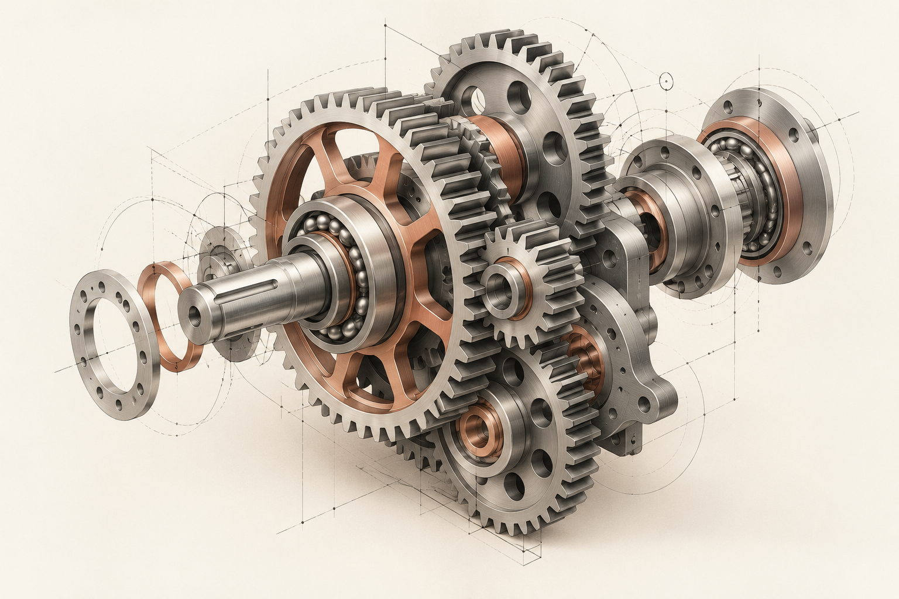

# 机械设计作品集

基于 SolidWorks 建模作品制作的在线作品集，供求职交流与设计能力展示。网站无需登录，按「封面 → 作品目录 → 作品详情」浏览。

**[查看在线作品集](https://mechanical-design-portfolio-2026.brinylynx32.chatgpt.site/)**

## 作品目录

| 作品 | 详情页 |
| --- | --- |
| V6 发动机 | [查看](dist/projects/v6-engine.html) |
| 多自由度机械手 | [查看](dist/projects/multi-axis-arm.html) |
| 农业无人机 | [查看](dist/projects/agricultural-drone.html) |
| 五爪夹持机构 | [查看](dist/projects/five-jaw-gripper.html) |
| 五指气动机械爪 | [查看](dist/projects/pneumatic-hand.html) |

## 网站文件

网站是无需构建步骤的静态 HTML、CSS 和 JavaScript 项目，页面与图片位于 [`dist/`](dist/) 目录。下载仓库后，可从 `dist/index.html` 开始浏览。在线站点由 Sites 托管；这个 GitHub 仓库保存网站源码和展示图片。

> [!NOTE]
> 封面齿轮图是装饰插画，五件作品的详情图为 SolidWorks 建模截图。作品展示不代表实物制造、性能验证或商业产品。

